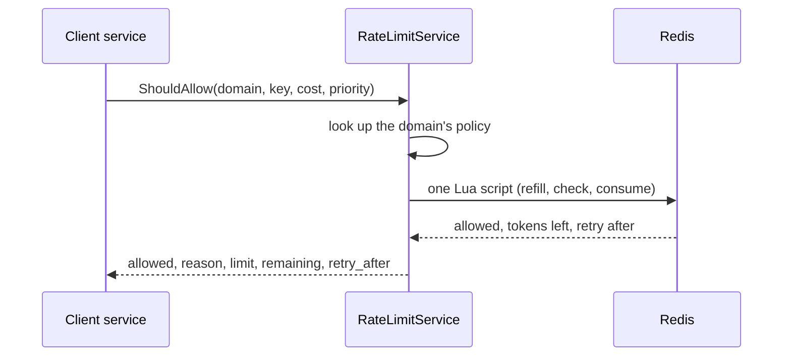
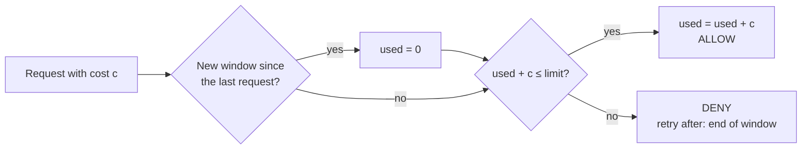
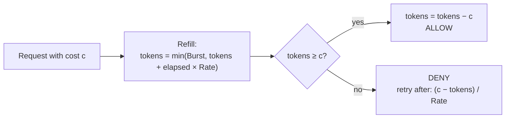
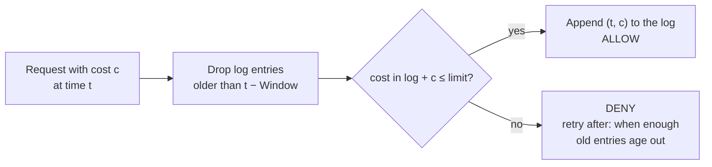
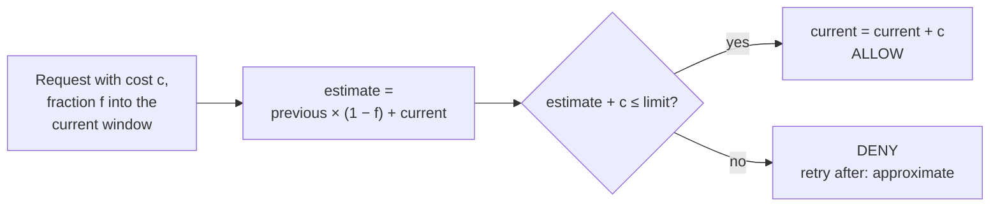

# ratelimit

A distributed rate limiter in Go. It ships as a library (pluggable algorithms, in-memory or Redis backends, gRPC interceptors) and as a standalone **RateLimitService** that other services call over RPC before doing expensive work.

> Status: **v0.1.0**. All ten [roadmap](#roadmap) steps are done; see the [changelog](CHANGELOG.md). The API may still change before 1.0.

---

## Why

This project is about **application-aware rate limiting**: limits that key off caller identity, tenant, request cost, and priority — so unfair or abusive use, expensive requests, and low-priority floods can be throttled without blunt, one-size-fits-all knobs.

## Goals

- Clear, swappable algorithms behind one interface
- Correct under concurrency (`go test -race` clean)
- Atomic distributed limiting via Redis + Lua (no read-modify-write races)
- **Cost-aware**: a request can consume more than one token
- **Priority-aware**: under pressure, shed sheddable traffic before critical traffic
- Measured, not guessed: benchmarks and load-test results in this README
- Explicit failure behavior (fail-open vs. fail-closed, configurable)

---

## Two ways to use it

### 1. As a library: gRPC interceptors

The limiter runs in-process. Requests over the limit fail fast with `RESOURCE_EXHAUSTED` and a `RetryInfo` detail.

```go
lim, err := memory.NewTokenBucket(memory.TokenBucketConfig{
    Rate:  10, // tokens per second
    Burst: 20, // bucket capacity
})
if err != nil {
    log.Fatal(err)
}

keyFunc := interceptor.KeyFromMetadata("x-api-key")
srv := grpc.NewServer(
    grpc.UnaryInterceptor(interceptor.Unary(lim, keyFunc)),
    grpc.StreamInterceptor(interceptor.Stream(lim, keyFunc, interceptor.PerMessage)),
)
```

Any `ratelimit.Limiter` works here, including `redisstore.TokenBucket` for a limit
shared across processes. The interceptors charge one token per call at default
priority; per-request cost and priority are available by calling the limiter (or the
service) directly. A runnable version is in
[`cmd/example-server`](cmd/example-server/main.go).

### 2. As a service: RateLimitService

Services ask a shared limiter before doing work. Redis holds the counters, so limits hold across the whole fleet.



API: [`proto/ratelimit/v1/ratelimit.proto`](proto/ratelimit/v1/ratelimit.proto). Built with `connect-go`, so the same service also answers plain HTTP/JSON:

```bash
docker compose up -d          # Redis
go run ./cmd/ratelimitd &     # the service, on :8080, reading policies.yaml

curl -s localhost:8080/ratelimit.v1.RateLimitService/ShouldAllow \
  -H 'Content-Type: application/json' \
  -d '{"domain":"api","key":"user:42","cost":1}'
# {"allowed":true, "reason":"REASON_OK", "limit":20, "remaining":19, "retryAfter":"0s", "policyId":"api"}
```

From Go, use the [`client`](client) package:

```go
c := client.New("http://localhost:8080", nil)
d, err := c.ShouldAllow(ctx, client.Check{
    Domain:   "api",
    Key:      "user:42",
    Cost:     5,
    Priority: client.PrioritySheddable,
})
if err != nil {
    return err
}
if !d.Allowed {
    // back off for d.RetryAfter
}
```

`ratelimitd` is configured through `REDIS_ADDR`, `POLICIES_PATH`, `ADDR` and
`REDIS_TIMEOUT`; see [`cmd/ratelimitd`](cmd/ratelimitd/main.go).

---

## Core interface

```go
type Limiter interface {
    Allow(ctx context.Context, req Request) (Decision, error)
}

type Request struct {
    Key      string
    Cost     int        // defaults to 1
    Priority Priority   // Critical, Default, Sheddable
}

type Decision struct {
    Allowed    bool
    Limit      int
    Remaining  int
    RetryAfter time.Duration
}
```

The in-memory limiters read time through an injectable `Clock`, so their tests are
deterministic (`clocktest` provides a fake one). The Redis backend uses Redis's own
clock instead; see [Time source](#time-source).

`Cost` is honored by every implementation. `Priority` is honored by the Redis backend
and the service; the in-memory limiters treat all priorities alike. A request whose
cost is larger than the limit can never succeed, so it returns `ErrCostExceedsLimit`
instead of a denial.

---

## Algorithms

| Algorithm | Memory per key | Accuracy | Burst handling | Notes |
|---|---|---|---|---|
| Fixed window | O(1) | Allows up to 2× at window edges | Poor | Simplest baseline |
| Token bucket | O(1) | Exact average rate | Explicit `Burst` | Good default |
| Sliding window log | O(requests) | Exact | Good | Memory-heavy at high rates |
| Sliding window counter | O(1) | Approximate (weighted) | Good | Best accuracy/memory trade-off |

All four are implemented in [`memory`](memory). The token bucket also has a Redis
implementation ([`redisstore`](redisstore)), which is what the service uses. In every
algorithm a denied request consumes nothing.

### Fixed window

Time is cut into windows of equal length, aligned to the Unix epoch, and each key has
one counter for the current window. A request is allowed if the counter plus its cost
stays within the limit; the counter starts again from zero when the next window
begins. It is the cheapest algorithm and the easiest to reason about, with one known
weakness: a client can spend the full limit at the end of one window and again at the
start of the next, which is up to twice the limit within a few milliseconds
(`TestWindowEdgeAccuracy` shows exactly that).



### Token bucket

Each key has a bucket that holds up to `Burst` tokens and refills continuously at
`Rate` tokens per second. A request takes `cost` tokens if the bucket has them and is
denied otherwise, with `RetryAfter` set to the time the missing tokens take to refill.
A new key starts with a full bucket. There are no windows, so there is no edge to
exploit: the long-run rate is exactly `Rate`, and `Burst` is the only source of
burstiness, set explicitly. This is the default choice, and the only algorithm with a
Redis implementation.



In the Redis version the check is `tokens − c ≥ floor`, where the floor depends on the
request's priority; see [Cost and priority](#cost-and-priority).

### Sliding window log

Each key keeps a log of the requests it was granted, with their timestamps and costs.
On every call, entries older than the window are dropped and the request is allowed
if the cost still in the log plus its own stays within the limit. The count is exact
over any interval of one window length, with no edge effect. The price is memory: one
log entry per granted request, so up to `Limit` entries per active key, which gets
expensive for high limits and many keys.



### Sliding window counter

An approximation of the sliding window log in constant memory. Each key keeps two
counters: the current epoch-aligned window and the one before it. The usage of the
trailing window is estimated as the current counter plus the previous counter weighted
by how much of the previous window the trailing window still overlaps. Halfway through
a window, half of the previous window's usage still counts. This removes the fixed
window's 2× edge burst. The estimate assumes the previous window's requests were
spread evenly, so it can be off when they were not, and `RetryAfter` is approximate
for the same reason.



---

## Design

### Atomicity in Redis

`redisstore.TokenBucket` runs the whole read-refill-check-write sequence as one Lua
script (`redisstore/tokenbucket.lua`), not separate GET/SET calls. Redis runs a
script to completion before serving any other command, so two clients racing for
the last token can't both win the way they could with a read-modify-write over
separate round trips. `TestTokenBucketIntegration`'s concurrent-key test exercises
this directly: 50 goroutines hit one key against a real Redis container, and
exactly `Burst` of them win, every time.

### Time source

Redis's own `TIME` command, not a timestamp the caller computed. Every app server
calling the same Redis agrees on "now" from one source, so their clocks don't need
to agree with each other -- only with Redis's. The cost is one more thing a client
can't fake or inject for testing (the in-memory limiters' `Clock` interface doesn't
apply here); the alternative, trusting each caller's own clock, would let clock
skew between app servers directly skew the limit.

### Cost and priority

**Cost**: `ShouldAllowRequest.cost` flows straight into the same `Request.Cost` /
`EffectiveCost()` every limiter already uses -- a cost-N request consumes N tokens
in one atomic check, the same whether it's checked via the Go `Limiter` interface
or RateLimitService over HTTP/JSON. (The gRPC interceptors always charge 1: they
have no hook yet for deriving a cost from the request. That is future work.)

**Priority**: each `redisstore.Policy` reserves a fraction of its bucket for
higher-priority traffic as it drains, via `ReserveForCritical` and
`ReserveForDefault` (both fractions of `Burst`, 0..1). A request's *floor* --
the minimum tokens its priority must leave behind -- is 0 for Critical,
`Burst*ReserveForCritical` for Default, and `Burst*(ReserveForCritical+ReserveForDefault)`
for Sheddable. Once the bucket drains below a priority's floor, only strictly
higher-priority traffic keeps getting through: that's the whole mechanism behind
"shed sheddable traffic before critical traffic." It's enforced inside the same
atomic Lua script as the refill-and-check (`floor` is just one more parameter),
so there's no separate accounting to keep in sync. Leave both reserves at 0 (the
default) for no reservation -- every priority can drain the bucket fully, same as
if Priority didn't exist.

### Streaming RPCs

`interceptor.Stream` supports both, via a `StreamMode`:

- **`PerStream`**: checks the limit once, before the handler runs. Limits how many
  streams a key may open (e.g. one long-lived subscription per key) -- cheap, and
  the natural choice when a stream's cost is in opening it, not in what flows after.
- **`PerMessage`**: checks before every message the client sends, by wrapping
  `RecvMsg`. Limits the rate of events a client pushes over one long-lived stream.

A stream hit mid-flight doesn't get torn down out of band: in `PerMessage` mode, the
*next* `RecvMsg` call returns the `ResourceExhausted` error instead of the client's
message, and it's up to the handler's own loop to notice that error and return (which
ends the RPC with that status) -- the interceptor can't unilaterally stop a handler
that's already running. `PerStream` mode never faces this: the only check happens
before the handler starts, so a denial there means the handler never runs at all.

### The extra hop

`ShouldAllowBatch` lets a caller check several keys in one round trip,
atomically: the whole batch is allowed only if every check in it is, and tokens
are only consumed when all of them pass. `redisstore/tokenbucketbatch.lua` does
that all-or-nothing check-and-commit server-side, in one script, rather than the
client making N separate calls and hoping nothing changes between them.

```bash
curl -s localhost:8080/ratelimit.v1.RateLimitService/ShouldAllowBatch \
  -H 'Content-Type: application/json' \
  -d '{"checks":[{"domain":"api","key":"user:7"},{"domain":"send-message","key":"tenant:acme","cost":2}]}'
```

The checks in one batch may belong to different domains with different policies;
`redisstore/tokenbucketbatchpolicy.lua` carries each key's own rate, burst and
priority floor. `client.ShouldAllowBatch` is the Go equivalent.

**Latency budget.** Using the service puts a network round trip in front of every
request it guards. What that costs, from the measurements under
[Benchmarks](#benchmarks) and [Load test](#load-test) (one machine, loopback, Redis in
a container, so a lower bound for a real network):

| Step | Cost |
|---|---|
| In-process token bucket, for comparison | 43 ns |
| One Redis `Allow` (Lua round trip), single caller | about 103 µs |
| Service on top of that (HTTP + connect), single caller | about 42 µs |
| Whole round trip, single caller | p50 141 µs, p99 207 µs |
| Whole round trip at 500 to 3000 requests/s (load test) | p50 0.20 to 0.99 ms, p99 0.43 to 1.52 ms |

So the budget to plan for is roughly a millisecond or two per guarded request in the
normal case, on top of the real network distance between caller and service, which
these numbers do not include. The worst case is bounded by two deadlines, not by the
network: the server gives Redis 50 ms (`REDIS_TIMEOUT`) before answering with the
domain's failure mode, and the Go client gives the service 200 ms
(`client.Config.Timeout`) before deciding locally. A request guarded through the Go
client therefore never waits more than the client timeout for its decision.

Ways to spend less of that budget:

- **Batching** (built). A request that needs several limits checked, such as per user
  and per tenant, pays for one round trip instead of several.
- **Running the limiter in-process** (built). A service that only needs a per-process
  limit, or that talks to Redis itself through `redisstore`, skips the hop to the
  service entirely.
- **A client-side token cache** (not built; future work). The client would lease a
  small block of tokens per key from the service and admit requests locally until
  the block runs out, so most requests make no call at all. The cost is accuracy: a
  key can overshoot by up to one leased block per client instance, and leased tokens
  that go unused are lost or have to be returned. It also needs a rule for which keys
  are worth leasing for, since it only pays off for busy keys.
- **Caching denials** (not built; future work). A denial already carries
  `retry_after`, so a client could refuse the same key locally until then without
  asking again. Priority makes this less simple than it sounds: a denial for a
  sheddable request says nothing about a critical one on the same key.

### Policies

`policies.yaml`, loaded by `policy.Load` and looked up fresh on every request --
not cached per-domain in `Server` -- so a hot reload takes effect on the very
next call, with no server-side state to invalidate:

```yaml
policies:
  api:
    rate: 10
    burst: 20
    reserve_for_critical: 0.3
    reserve_for_default: 0.2
  send-message:
    rate: 2
    burst: 5
    reserve_for_critical: 0.5

default:            # applied to any domain with no entry above
  rate: 5
  burst: 10
```

`policy.Store.Watch` reloads on any write to the file (watching its parent
directory, not the file itself, since many editors and config-management tools
replace a file via rename rather than writing it in place -- a watch on the file
alone can miss that). A reload that fails to parse or validate is logged and
discarded: the `Store` keeps serving its last good snapshot rather than falling
back to a placeholder policy for every domain over one bad edit.

**What happens to in-flight counters when a limit changes**: nothing has to,
by design. Redis holds each key's raw token count, not "tokens as a fraction
of the configured burst" -- so a policy change just changes what that count
means going forward, with no migration needed. The one sharp edge: the Lua
script clamps `tokens` to `burst` on every access (`math.min(burst, ...)`), so
lowering `Burst` below a key's current count caps it down to the new ceiling
immediately, on its very next request -- not gradually. A caller that had
built up a large burst loses that headroom in one step the moment the new
policy takes effect, rather than spending it down first.

### Failure modes

A rate limiter sits in front of other services, so when it breaks, the
question is what it does to them. There are two places it can break, and each
is handled where the most information is available.

**Redis unavailable (service up).** Every Redis call runs under a deadline
(`REDIS_TIMEOUT`, default 50ms, `service.WithBackendTimeout`). If the call
errors or times out, the server doesn't return an error. It answers using the
domain's `failure_mode` from the policy file:

```yaml
policies:
  send-message:
    rate: 2
    burst: 5
    failure_mode: fail_closed   # or fail_open; default fail_open
```

| `failure_mode` | Answer | `reason` |
|---|---|---|
| `fail_open` (default) | allowed, `remaining: 0` | `REASON_FAIL_OPEN` |
| `fail_closed` | denied, `retry_after` = one token's refill time (`1/rate`) | `REASON_FAIL_CLOSED` |

**The default is `fail_open`.** For most domains a limiter outage shouldn't
also take down every service that calls it. Use `fail_closed` for domains
where overrunning the limit is worse than refusing traffic, such as a paid
third-party API or a fragile downstream. `failure_mode` hot-reloads like every
other policy field. An unknown value (`fail-closed`, `open`) fails the reload,
so a typo can't silently fail open. A batch with checks in several domains
answers each check by its own domain's mode, and is allowed only if all of
them are, i.e. only if every domain in it is `fail_open`.

The `reason` is what lets callers and dashboards tell an admission under
failure from a real one. `REASON_OK` means Redis counted the request.
`REASON_FAIL_OPEN` means nobody did. Two cases are never answered by the
failure mode:
- **Invalid requests** (empty key, cost above burst) are still
  `InvalidArgument`, so a fail-open allow can't hide a caller bug.
- **A caller that cancelled or ran past its own deadline** gets `Canceled` or
  `DeadlineExceeded`. Only the server's own Redis timeout triggers the
  failure mode.

The server is only as good as go-redis's deadline handling.
`redis.Options.ContextTimeoutEnabled` must be set (`ratelimitd` sets it).
Without it, go-redis ignores context deadlines on socket reads, so a stalled
Redis holds each call for its own 3s `ReadTimeout`.

**RateLimitService unreachable (client side).** The Go client puts a deadline
on every call (`client.Config.Timeout`, default 200ms). If the service can't
be reached (`Unavailable`) or doesn't answer in time, the client decides
locally using `Config.Fallback`:

| `client.FallbackMode` | Result |
|---|---|
| `FallbackFailOpen` (default) | allowed, `Reason: ReasonFailOpen` |
| `FallbackFailClosed` | denied, `Reason: ReasonFailClosed`, `RetryAfter: Config.FallbackRetryAfter` (default 1s) |
| `FallbackError` | the error is returned; the caller decides |

`Config.DomainFallback` overrides the mode per domain and should normally
mirror the server's `failure_mode` for that domain. The client can't read the
policy file, so the two must be configured separately. A local decision sets
`Decision.Fallback = true` and keeps the cause in `Decision.FallbackCause`. A
server-side failure-mode answer arrives with `Fallback = false`, so callers can
tell "Redis was down, the server decided" from "the service was down, the
client decided". The client's 200ms default sits above the server's 50ms Redis
timeout on purpose. When only Redis is slow, the server answers first with the
domain's configured mode, which the client may not know.

**No circuit breaker (yet).** During an outage, every request waits out the
full timeout before the failure mode applies, so while Redis hangs, request
latency rises to about `REDIS_TIMEOUT`. A breaker would stop calling Redis
after repeated failures and answer immediately. It was left out of step 9 to
keep the change small: done properly it needs per-instance failure tracking, a
half-open probe to detect recovery, and a decision about whether batches
count as one failure or many. It's future work. Until then, `REDIS_TIMEOUT`
caps the added latency.

### Concurrency (in-memory backend)

Each in-memory limiter keeps its per-key state in a `shardedMap`: the
key space is split across a fixed number of shards (32 by default),
each with its own mutex, instead of one mutex for the whole limiter. A
single mutex serializes every key, even ones that never contend with
each other; sharding by key hash removes that false contention. It does
nothing for one hot key, which still serializes on that key's shard.

Measured with `BenchmarkFixedWindow_ShardCount`: parallel callers spread
over 1024 keys, one mutex for everything (`shards=1`) against the default
(`shards=32`), at several `GOMAXPROCS` values. Median ns/op of 5 runs;
lower is better.

| GOMAXPROCS | 1 shard (single mutex) | 32 shards (default) | Sharded is faster by |
|---|---|---|---|
| 1 | 47.1 | 48.2 | 0.98x |
| 2 | 92.5 | 47.7 | 1.9x |
| 4 | 122.4 | 33.5 | 3.7x |
| 8 | 159.2 | 38.5 | 4.1x |
| 10 | 171.9 | 41.0 | 4.2x |

`go test -run '^$' -bench BenchmarkFixedWindow_ShardCount -benchmem -count=5 -cpu 1,2,4,8,10 ./memory/`
on the machine described under [Benchmarks](#benchmarks); raw output in
[`bench/raw/shards-gomaxprocs.txt`](bench/raw/shards-gomaxprocs.txt).

What the numbers say:

- **With one core there is nothing to win.** Both variants cost about 47-48
  ns per call; sharding adds no measurable overhead and no benefit.
- **The single mutex gets slower with every core added.** Per-call cost
  rises from 47.1 ns to 171.9 ns between 1 and 10 cores, so total
  throughput *falls* by about 3.6x: more cores means more time spent
  handing the lock around, not more work done.
- **Sharding stops that collapse, but it does not scale linearly.** With 32
  shards the per-call cost stays between 33.5 and 48.2 ns at every core
  count. Ten cores do about 1.2x the work of one, not 10x. The 4.2x gap at
  10 cores is mostly the single mutex getting worse, not the sharded map
  getting faster.
- **Best throughput is at 4 cores**, and it drops slightly at 8 and 10. This
  machine has 4 performance and 6 efficiency cores, so the extra cores are
  slower ones; that is a likely contributor, but it was not isolated here.

Why sharded throughput stays nearly flat was not investigated in this pass.
A plausible cause is the benchmark's shape: every goroutine walks the same
1024 keys in the same order, so every core keeps touching every shard's
mutex and entries, and those cache lines bounce between cores even when no
goroutine actually waits for a lock. That is a hypothesis, not a
measurement.

A single hot key gets no help from sharding, as expected: `SingleKey` in the
table below (every call on one key) costs 174-181 ns at 10 cores, close to
the single-mutex figure (171.9 ns).

---

## Benchmarks

Machine: Apple M5 (`Mac17,3`), 10 cores (4 performance + 6 efficiency), 24 GB
RAM, macOS 26.6.2, go1.27.2 darwin/arm64. Redis 7.4.11 (`redis:7-alpine`) in
Docker Desktop (engine 29.8.2). Run on 2026-11-10; the machine was not idle
(load average 2.8-4.6). Every figure is the median of 5 runs
(`-count=5`); raw output, per-benchmark min/max and the exact commands are in
[`bench/`](bench/README.md).

### In-memory limiters

`go test -run '^$' -bench . -benchmem -count=5 ./memory/`, `GOMAXPROCS=10`.
`SingleKey` is every call hitting the same key (worst case: one shard does all the work);
`ManyKeys` spreads calls over 1024 distinct keys in parallel (where sharding pays off).

| Algorithm | ns/op (SingleKey) | ns/op (ManyKeys) | allocs/op |
|---|---|---|---|
| fixed window | 175.8 | 40.6 | 0 |
| token bucket | 173.7 | 43.4 | 0 |
| sliding window log | 177.2 | 67.6 | 0 (small heap growth, see below) |
| sliding window counter | 181.2 | 47.4 | 0 |

Sliding window log reports 0 allocs/op but nonzero B/op (26-30 for `SingleKey`, 155-177
for `ManyKeys`) under `-benchmem`: its per-key log occasionally grows its backing slice
via `append`, which `go test` attributes to the slice's bytes rather than a separate
allocation count. It's also the one algorithm
whose *time* per call isn't O(1): Allow is O(stale entries evicted) amortized, which an
earlier version of this benchmark caught failing at -- it was resumming the entire log by
hand on every call instead of tracking total cost incrementally, making each call O(log
length). Fixed before these numbers were taken; see `logState` in `slidingwindowlog.go`.

### Redis backend and service round trip

`go test -run '^$' -bench . -benchmem -count=5 ./redisstore/ ./service/`. Both start a
Redis container through testcontainers. `Serial` is one caller, so ns/op is the latency
of one call. `Parallel` is `GOMAXPROCS=10` concurrent callers, so ns/op there is
wall time divided by calls (the inverse of throughput), not latency.

| Benchmark | ns/op (Serial) | ns/op (Parallel) | allocs/op | p50 / p99 |
|---|---|---|---|---|
| redis / token bucket, one hot key | 102,810 | 33,549 | 20 | not measured |
| redis / token bucket, 1024 keys | (same benchmark as above) | 33,613 | 20 | not measured |
| service round-trip, serial | 144,624 | | 175 | 141 µs / 207 µs |
| service round-trip, parallel | | 47,837 | 174 | 473 µs / 848 µs |

- One Redis `Allow` (one Lua round trip) takes about 103 µs for a single caller, and
  ten parallel callers get about 29,800 calls/s in total. Hot key or 1024 keys makes no
  difference (33,549 vs 33,613 ns/op): Redis runs scripts one at a time either way.
- The service adds about 42 µs on top of the Redis call for a single caller
  (144.6 µs vs 102.8 µs), and 155 allocations per request (175 vs 20), from HTTP and
  connect. Ten parallel callers get about 20,900 requests/s.
- The Redis call is roughly 2,400x the cost of the in-memory token bucket
  (102,810 ns vs 43.4 ns). The network round trip dominates, and here it crosses
  Docker Desktop's macOS-to-VM boundary, so these numbers are specific to this setup.
- The parallel p99 is the least stable figure: 0.70 ms to 1.48 ms across the five runs.

## Load test

**Harness.** [`cmd/loadtest`](cmd/loadtest) drives a running `ratelimitd` through the Go
client. It is open-loop: requests go out on a fixed schedule that does not wait for
responses, and latency is measured from each request's *scheduled* send time, so a slow
server shows up as latency instead of quietly lowering the offered rate. Keys, costs and
priorities are sampled from a seeded generator, so a run is repeatable. Accuracy compares
admitted tokens with the most a correct token bucket may admit per key,
`min(requested, burst + rate × duration)`.

**Setup.** Redis 7.4.11 from `docker compose`; `ratelimitd` and the harness as host
processes on the machine above, over loopback. Domain `api` from
[`policies.yaml`](policies.yaml): 10 tokens/s and burst 20 per key, 30% of burst reserved
for critical and a further 20% for default. 100 keys, so the sustained limit is 1000
requests/s in aggregate. Cost 1, priority mix 10% critical / 60% default / 30% sheddable,
30 s per scenario:

```bash
docker compose up -d && go run ./cmd/ratelimitd &
go run ./cmd/loadtest -domain api -rate 10 -burst 20 -rps <500|1000|3000> \
  -duration 30s -keys 100 -cost 1 -mix critical=10,default=60,sheddable=30 -seed 1
```

**Throughput and latency**

| Scenario | Offered | Throughput | p50 | p99 | max | Errors / dropped |
|---|---|---|---|---|---|---|
| Under the limit (0.5x) | 500 rps | 500.0 rps | 0.99 ms | 1.52 ms | 19.96 ms | 0 / 0 |
| At the limit (1x) | 1000 rps | 1000.0 rps | 0.75 ms | 1.33 ms | 11.68 ms | 0 / 0 |
| Overload (3x) | 3000 rps | 3000.0 rps | 0.20 ms | 0.43 ms | 37.81 ms | 0 / 0 |

**Accuracy**

| Scenario | Admitted | Most a correct limiter may admit | Ratio | Over-admitted |
|---|---|---|---|---|
| Under the limit | 15,000 | 15,000 | 1.000 | 0 |
| At the limit | 28,846 | 29,915 | 0.964 | 0 |
| Overload (3x) | 31,267 | 32,000 | 0.977 | 0 |

**Success rate by priority** (allowed / sent)

| Scenario | Critical | Default | Sheddable |
|---|---|---|---|
| Under the limit | 100.0% (1,480 / 1,480) | 100.0% (8,954 / 8,954) | 100.0% (4,566 / 4,566) |
| At the limit | 100.0% (2,925 / 2,925) | 99.7% (18,048 / 18,096) | 87.7% (7,873 / 8,979) |
| Overload (3x) | 100.0% (8,924 / 8,924) | 40.4% (21,918 / 54,296) | 1.6% (425 / 26,780) |

What the results show:

- **The limit was never exceeded.** Over-admitted tokens are 0 in all three runs.
- **Shedding follows priority.** At 3x overload every critical request got through,
  default kept 40.4%, and sheddable was cut to 1.6%.
- **Sheddable traffic is shed before the limit is reached.** At exactly 1x, 12.3% of
  sheddable requests were denied and 3.6% of the allowance went unused. Keys are picked
  at random, so a key regularly gets a short burst above its rate; its bucket then dips
  below the sheddable floor (half the burst) and sheddable requests are refused although
  tokens remain. This is the reserve working as configured, and it is the price of it.
- **Under overload about 2.3% of the allowance stays unused** (733 of 32,000 tokens). That
  is consistent with each of the 100 buckets ending the run near the critical reserve
  (6 tokens) that default and sheddable traffic may not spend, though no per-key trace
  was taken to confirm it.
- **Latency went down as load went up** (p50 0.99 ms at 500 rps, 0.20 ms at 3000 rps),
  the opposite of what a loaded server normally does. The cause was not investigated. At
  low rates each request probably finds idle connections and sleeping threads, on a
  path that includes Docker Desktop's network proxy, and pays to wake them up; treat
  the low-rate latencies as a property of this setup, not of the limiter.
- **These runs overload the limit, not the service.** 3000 rps is well below the roughly
  20,900 requests/s the round-trip benchmark reached, so throughput equals the offered
  rate in every scenario. The service's saturation point was not load-tested.

Raw harness output and JSON summaries: [`bench/raw/loadtest/`](bench/raw/loadtest).

---

## Scaling further

What the current design does at higher load, and what would have to change. Nothing
in this section beyond the "today" paragraphs is built.

**Today.** Every check through the service is one Redis round trip against one Redis
instance. Redis runs the Lua scripts one at a time, so that instance is the ceiling:
on the benchmark machine ten parallel callers got about 29,800 `Allow` calls per
second from Redis directly and about 20,900 requests per second through the service.
`ratelimitd` itself holds no counters, so any number of instances can run side by side
against the same Redis; adding instances adds HTTP capacity, not Redis capacity. Redis
memory is bounded by the number of *active* keys: each bucket is one small hash that
expires after twice its refill time (at least 60 s) without traffic. The in-memory
limiters are different: they never evict a key, so their memory grows with the number
of distinct keys seen until the process restarts.

**Local pre-aggregation (future work).** The first thing to give at 100× is the
one-round-trip-per-request rule. Each service instance, or each client, would take
tokens from Redis in blocks and admit requests from its local block, turning N Redis
calls into one per block. This is the same idea as the client-side token cache under
[The extra hop](#the-extra-hop), and it has the same price: the limit becomes
approximate by up to (number of holders × block size), and blocks need an expiry so
tokens held by an idle or crashed holder flow back. Block size would have to adapt:
large for busy keys, zero for quiet ones.

**Redis Cluster key hashing (future work).** One Redis instance is also a single
point of failure and a memory ceiling. Today the code takes a `*redis.Client`, which
talks to one instance, and it is not Cluster-ready for one specific reason: the batch
scripts touch several keys in one script, and Cluster only allows that when all the
keys hash to the same slot. Bucket keys look like `ratelimit:tb:<domain>:<key>`, with
no hash tag, so the keys of a typical batch (a user and a tenant) would land on
different shards and the script would be rejected. The single-key path has no such
problem. The options are to add hash tags so that keys that are batched together
share a slot, which only works when there is a natural grouping such as the tenant,
or to give up atomicity for cross-slot batches and check each shard separately, with
a refund step when one of them denies. Neither is implemented.

**Hot keys.** One very busy key is the case sharding does not help, in either
backend. In memory, all calls for one key serialize on that key's lock (174 to 181 ns
per call at 10 cores, against 41 to 68 ns when calls are spread over many keys). In
Redis, a hot key costs the same as any other key on a single instance (33,549 vs
33,613 ns per call), but in a cluster it would pin all of its load to one shard, and
no amount of rebalancing moves it. The fix is again local pre-aggregation, applied
only to the keys that need it: detect the hot keys and serve them from leased blocks.
Not implemented.

**Regional vs. global limits (future work).** Today a limit is exactly as global as
its Redis: every caller of one Redis shares one bucket per key, and there is no notion
of region. Serving several regions from one Redis keeps limits exact but adds a
cross-region round trip to every request far from it, and makes that region's Redis a
dependency for all of them. The alternative is one Redis per region. Then each limit
has to be either regional on purpose (each region enforces its own share of the
quota, which wastes capacity when traffic is uneven) or global and approximate
(regions exchange usage in the background and each enforces against a slightly stale
total). Which one is right depends on what the limit protects: a regional backend's
capacity is naturally a regional limit, while a customer's paid quota is naturally
global. The policy file has no way to say this yet.

---

## Roadmap

Each step was sized for one ~45-minute session. All ten are done.

**Library**
- [x] **1. Scaffold**: `go mod init`, `Limiter` interface, `Clock` abstraction, fixed window (in-memory), table-driven tests, GitHub Actions (`go test -race`, `golangci-lint`)
- [x] **2. Token bucket**: in-memory implementation, fake-clock tests for refill, burst, and cost > 1
- [x] **3. Sliding windows**: log and counter variants; a test comparing accuracy against fixed window at window edges
- [x] **4. Concurrency**: sharded locks, `-race` stress test, first benchmarks
- [x] **5. gRPC interceptors**: unary + streaming, `RESOURCE_EXHAUSTED` with `RetryInfo`, key extraction from metadata, example server
- [x] **6. Redis backend**: token bucket in Lua, `docker-compose`, integration tests (testcontainers)

**Service**
- [x] **7. RateLimitService**: `.proto`, `buf generate`, connect-go server backed by Redis, Go client
- [x] **8. Priority + policies**: criticality-aware shedding, YAML policies per domain with hot reload
- [x] **9. Failure modes + load test**: fail-open/closed per domain, timeouts, client-side fallback, load harness
- [x] **10. Polish**: load-test results in README, fill in Design sections, diagrams, release `v0.1.0`, write the post ([draft](docs/post.md))

---

## Project layout

```
.
├── limiter.go               # Limiter, Request, Decision, Priority, Clock
├── example_test.go          # runnable example for the core interface
├── clocktest/               # fake clock for deterministic tests
├── memory/                  # in-memory algorithms + sharded per-key locks
├── redisstore/              # Redis token bucket + Lua scripts (single, batch, cross-policy batch)
├── interceptor/             # gRPC unary + stream interceptors
├── proto/ratelimit/v1/      # service API
├── gen/                     # generated code (buf)
├── service/                 # RateLimitService server
├── policy/                  # YAML policy loading + hot reload
├── client/                  # Go client with per-call deadlines + fallback
├── cmd/
│   ├── ratelimitd/          # the service binary
│   ├── example-server/      # gRPC server with the interceptors wired in
│   └── loadtest/            # open-loop load harness
├── bench/                   # raw benchmark + load-test output behind the README numbers
├── docs/post.md             # write-up draft
├── CHANGELOG.md
├── policies.yaml            # example per-domain policies, used by ratelimitd
├── buf.yaml, buf.gen.yaml
├── docker-compose.yml       # Redis for local runs
└── .github/workflows/ci.yml
```

## License

MIT
